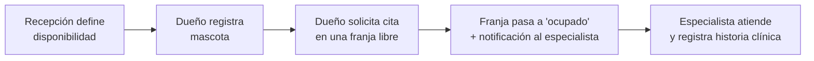
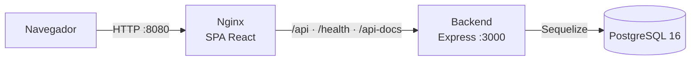
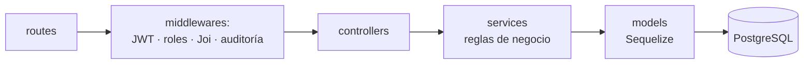
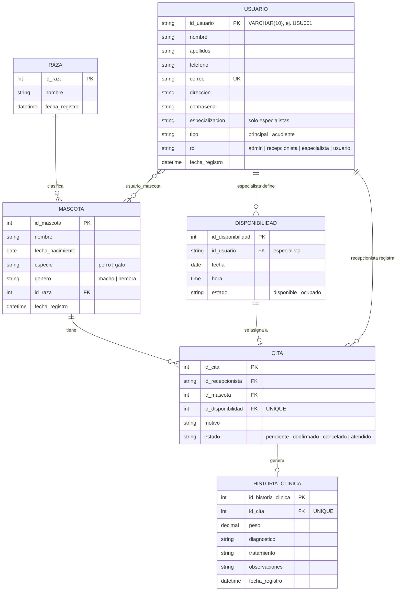

# 🐾 Huellitas Saludables

# INTEGRANTES
Santiago Buitrago Goyeneche 
Sara Jasmin Cruz
Jorge ALejandro Torres

Sistema web para la gestión de una veterinaria: registro de mascotas, agendamiento de citas según la disponibilidad de los especialistas e historias clínicas, con acceso diferenciado por rol.

| | |
|---|---|
| **Frontend** | React 18 · TypeScript · Vite · Nginx |
| **Backend** | Node.js 22 · Express 4 · Sequelize 6 |
| **Base de datos** | PostgreSQL 16 |
| **Autenticación** | JWT (`Authorization: Bearer <token>`) + autorización por roles |
| **Despliegue** | Docker Compose (3 contenedores) |
| **Documentación API** | Swagger / OpenAPI en `/api-docs` |
| **Estado** | En desarrollo · apto para entorno académico/demo, **no listo para producción** (ver [Seguridad](#9-seguridad-y-riesgos-conocidos)) |

---

## Índice

1. [Visión del proyecto](#1-visión-del-proyecto)
2. [Stack tecnológico](#2-stack-tecnológico)
3. [Arquitectura](#3-arquitectura)
4. [Datos e interfaces](#4-datos-e-interfaces)
5. [Calidad y pruebas](#5-calidad-y-pruebas)
6. [Infraestructura y DevOps](#6-infraestructura-y-devops)
7. [Puesta en marcha](#7-puesta-en-marcha)
8. [Decisiones técnicas](#8-decisiones-técnicas)
9. [Seguridad y riesgos conocidos](#9-seguridad-y-riesgos-conocidos)
10. [Backlog técnico](#10-backlog-técnico)
11. [Documentación y estructura del repositorio](#11-documentación-y-estructura-del-repositorio)

---

## 1. Visión del proyecto

### Qué resuelve
Centraliza en una sola aplicación el flujo operativo de una veterinaria: el dueño registra sus mascotas y pide cita; recepción administra la agenda de los especialistas; el especialista consulta sus citas y deja la historia clínica.

### Roles

| Rol | Qué puede hacer |
|---|---|
| `usuario` (dueño) | Registrar mascotas, solicitar, editar y cancelar citas |
| `recepcionista` | Gestionar disponibilidad de especialistas, crear/editar/cancelar citas |
| `especialista` | Ver sus citas, consultar y crear/actualizar historias clínicas |
| `admin` | Crear cuentas de personal, gestionar disponibilidad y citas, registrar mascotas |

### Requisitos funcionales cubiertos

| RF | Requisito | Implementación | Estado |
|---|---|---|---|
| RF07 | El dueño solicita citas según disponibilidad | `POST /api/citas` · `services/cita.service.js` | ✅ Implementado |
| RF08 | Recepción gestiona disponibilidad y agenda | CRUD en `routes/disponibilidad.routes.js` | ✅ Implementado |
| RF09 | Notificar a los veterinarios sobre citas y cambios | `services/notificacion.service.js` | ⚠️ Stub: solo escribe en consola |
| RF10 | El veterinario consulta sus citas asignadas | `GET /api/citas/especialista/:id` · pantalla `CitasEspecialista` | ✅ Implementado |
| RF15 | Auditoría de acciones de admin/recepción | `middlewares/auditLog.js` | ⚠️ Solo log en consola, sin persistencia |

### Flujo principal



---

## 2. Stack tecnológico

| Capa | Tecnología | Versión | Para qué se usa |
|---|---|---|---|
| Runtime | Node.js (CommonJS) | 22 (imagen `node:22-alpine`) | Ejecutar la API |
| API | Express | ^4.18 | Rutas y middlewares |
| ORM | Sequelize + `pg` | ^6.37 / ^8.23 | Modelos, asociaciones y consultas |
| Migraciones | `sequelize-cli` | ^6.6 | Versionar el esquema y cargar *seeders* |
| Base de datos | PostgreSQL | 16 (`postgres:16-alpine`) | Persistencia relacional |
| Autenticación | `jsonwebtoken` | ^9 | Emitir y verificar JWT (expiración por defecto: 8 h) |
| Validación | Joi | ^17.13 | Validar y normalizar entradas HTTP |
| Docs API | `swagger-jsdoc` + `swagger-ui-express` | ^6.2 / ^5 | OpenAPI en `/api-docs` |
| Pruebas | Jest + Supertest | ^30 / ^7 | Pruebas unitarias e integración del backend |
| Frontend | React + TypeScript | ^18.3 / ^5.7 | SPA |
| Build/Dev | Vite | ^6 | Bundler y servidor de desarrollo |
| Ruteo / HTTP | `react-router-dom` / `axios` | ^7 / ^1.7 | Navegación y consumo de la API |
| Servidor web | Nginx | 1.27-alpine | Sirve la SPA y hace proxy a la API |
| Contenedores | Docker + Compose v2 | — | Orquestación local y de pruebas |

> La justificación de cada elección está en el [registro de decisiones técnicas](#8-decisiones-técnicas).

---

## 3. Arquitectura

### Vista general



- En **Docker**, Nginx sirve la SPA y reenvía `/api`, `/health` y `/api-docs` al backend (`VITE_API_URL=/api`).
- En **desarrollo local**, Vite corre aparte (puerto `5173`) y habla con `http://localhost:3000/api`.

### Patrón del backend: capas



| Capa | Carpeta | Responsabilidad |
|---|---|---|
| Rutas | `back/app/routes/` | Declaran endpoints y los roles permitidos |
| Middlewares | `back/app/middlewares/` | `identifyUser` (JWT), `validate` (Joi), `auditLog`, `errorHandler` |
| Controladores | `back/app/controllers/` | Adaptan HTTP ↔ servicios |
| Servicios | `back/app/services/` | Lógica de negocio (citas, disponibilidad, historias…) |
| Modelos | `back/app/models/` | Tablas y asociaciones (fuente de verdad: `models/index.js`) |
| Esquemas | `back/app/schemas/` | Validaciones Joi por dominio |

### Frontend

| Ruta | Pantalla | Acceso |
|---|---|---|
| `/` · `/login` · `/registro` | Inicio, ingreso, registro | Público |
| `/dashboard` | Panel principal | Sesión iniciada |
| `/mascotas` · `/mascotas/nueva` | Lista y alta de mascotas | Sesión iniciada (la API valida el rol) |
| `/citas/nueva` | Solicitar cita | Sesión iniciada |
| `/disponibilidad` | Administrar horarios | `recepcionista`, `admin` |
| `/citas/especialista` | Citas asignadas | `especialista` |

Las rutas protegidas usan `PrivateRoute` y `RoleRoute`. **El frontend solo mejora la navegación; la seguridad real la aplica el backend.**

### Flujo de autenticación

1. `POST /api/auth/login` con correo y contraseña → la API devuelve un JWT.
2. El frontend lo guarda en `localStorage`; `axios` lo adjunta en cada petición.
3. El backend verifica la firma y confirma que el usuario siga existiendo, leyendo su **rol vigente desde la base de datos**.
4. Si responde `401`, el frontend borra la sesión y vuelve a `/login`.

---

## 4. Datos e interfaces

### Modelo entidad-relación

> Fuente de verdad: `back/app/models/index.js` y `back/migrations/`.



### Reglas de integridad (en base de datos)

- **Una franja, una cita:** `cita.id_disponibilidad` es `UNIQUE`; un *trigger* (`trg_actualizar_disponibilidad_cita`) marca la franja como `ocupado` al insertar la cita.
- **Sin franjas duplicadas:** `UNIQUE (id_usuario, fecha, hora)` en `disponibilidad`.
- **Una historia por cita:** `historia_clinica.id_cita` es `UNIQUE`.
- Claves foráneas con `ON DELETE RESTRICT` y restricciones `CHECK` para estados.

### Contrato de la API

- Documentación interactiva: **`/api-docs`** (Swagger). Detalle de campos en `back/app/config/swagger.js` y `back/app/schemas/`.
- Formato de autenticación: `Authorization: Bearer <token>`.
- Rutas públicas: `GET /health`, `POST /api/auth/login`, `POST /api/auth/registro`.

| Recurso | Rutas principales | Quién escribe |
|---|---|---|
| Auth | `/api/auth/login` · `/registro` · `/registro-admin` · `/perfil` | Público · `admin` (registro-admin) |
| Mascotas | `GET/POST /api/mascotas` · `GET /api/mascotas/{id}` | `usuario`, `admin` |
| Razas · Usuarios | `GET /api/razas` · `GET /api/usuarios/especialistas` · `GET /api/usuarios/{id}` | Lectura con JWT |
| Disponibilidad | `GET/POST/PUT/DELETE /api/disponibilidad` · `GET …/especialista/{id}` | `recepcionista`, `admin` |
| Citas | `GET/POST/PUT /api/citas` · `PATCH /api/citas/{id}/cancelar` · `GET …/especialista/{id}` | `usuario`, `recepcionista`, `admin` |
| Historia clínica | `GET/POST/PUT /api/historia` · `GET …/mascota/{id}` · `GET …/cita/{id}` | `especialista` |

Lista completa con roles: [`docs/backend/API.md`](docs/backend/API.md). Códigos habituales: `400` validación · `401` token ausente/inválido · `403` rol sin permiso · `404` no encontrado · `503` sin base de datos.

---

## 5. Calidad y pruebas

```text
          ▲  E2E (navegador)        → no existe
         ╱ ╲
        ╱   ╲ Integración (API+BD)  → 6 archivos · Jest + Supertest
       ╱─────╲
      ╱       ╲ Unitarias           → 2 archivos (jwt, auth.service)
     ╱─────────╲
```

| Indicador | Valor |
|---|---|
| Archivos de prueba | 8 (en `back/tests/`) |
| Casos `it()` declarados | 112 |
| Cubre | Login/registro, JWT, `401`/`403`, citas, disponibilidad (filtros, paginación, conflictos), historias, mascotas, usuarios |
| No cubre | Frontend (sin tests), pruebas E2E, pruebas de carga |
| Aislamiento | Base temporal `proyectohs_test` recreada en cada ejecución |

> ⚠️ **La suite borra y recrea la base indicada en `DB_NAME_TEST`.** No la apuntes a una base con datos que quieras conservar.

```bash
cd back
cp .env.test.example .env.test      # ajusta credenciales de PostgreSQL
npm ci
npm test                            # toda la suite (en serie)
npm run test:coverage               # con cobertura → back/coverage/
```

Sin PostgreSQL local, usa la base temporal de Docker:

```bash
docker compose -f docker-compose.test.yml up --build --abort-on-container-exit --exit-code-from tests
docker compose -f docker-compose.test.yml down -v
```

Más detalle en [`docs/tests/PRUEBAS.md`](docs/tests/PRUEBAS.md).

---

## 6. Infraestructura y DevOps

### Entornos

| Entorno | Cómo se levanta | Notas |
|---|---|---|
| Local con Docker | `docker compose up -d --build` | Puerto `8080`; migraciones automáticas al iniciar |
| Local sin Docker | `npm run dev` en `back/` y `front/` | Requiere PostgreSQL propio |
| Pruebas | `docker-compose.test.yml` o `npm test` | BD temporal (`tmpfs` en Docker) |
| Producción | — | **No definido todavía** (ver backlog) |

### Contenedores (`docker-compose.yml`)

| Servicio | Imagen | Función |
|---|---|---|
| `db` | `postgres:16-alpine` | Datos persistidos en el volumen `postgres_data` |
| `backend` | Build de `back/Dockerfile` | Espera a la BD → migra → (opcional) siembra → inicia la API |
| `frontend` | Build multi-etapa + `nginx:1.27-alpine` | Sirve la SPA y hace proxy a la API |

Los tres tienen *healthchecks* y orden de arranque (`depends_on: service_healthy`). Detalles en [`DOCKER.md`](DOCKER.md).

### Variables de entorno

| Variable | Descripción |
|---|---|
| `APP_PORT` | Puerto publicado por Nginx (por defecto `8080`) |
| `DB_NAME` · `DB_USER` · `DB_PASSWORD` | Conexión a PostgreSQL |
| `DB_NAME_TEST` | Base **desechable** para pruebas |
| `JWT_SECRET` | Secreto de firma de tokens — **obligatorio cambiarlo** |
| `JWT_EXPIRES_IN` | Vigencia del token (defecto `8h`) |
| `CORS_ORIGIN` | Orígenes permitidos — *hoy el backend no la usa* (ver seguridad) |
| `VITE_API_URL` | URL de la API para el frontend (`/api` en Docker) |
| `DB_SEED` | `true` carga datos demo en el primer arranque |

### CI/CD
**Aún no hay pipeline configurado.** Propuesta mínima en el [backlog](#10-backlog-técnico): `install → lint → type-check → test → build` en cada *pull request*.

---

## 7. Puesta en marcha

### Opción A — Docker (recomendada)

Requiere Docker Engine y Docker Compose v2.

```bash
cp .env.docker.example .env
# Edita .env: cambia como mínimo DB_PASSWORD y JWT_SECRET.
# Para cargar datos de demostración en el primer arranque: DB_SEED=true

docker compose up -d --build
docker compose ps
```

Las migraciones se aplican solas al arrancar el backend. Abre:

- App → <http://localhost:8080>
- Salud de la API → <http://localhost:8080/health>
- Swagger → <http://localhost:8080/api-docs>

Si ya levantaste el sistema sin `DB_SEED` y quieres datos demo después:

```bash
docker compose exec backend npx sequelize-cli db:seed:all
```

Detener sin perder datos: `docker compose down`.
**`docker compose down -v` borra también el volumen de PostgreSQL.**

> **Linux — `permission denied` con Docker:** agrega tu usuario al grupo `docker` (`sudo usermod -aG docker $USER`) y abre una sesión nueva, o usa `newgrp docker`.

### Opción B — Sin Docker

Requiere Node.js 22, npm y PostgreSQL 16 en ejecución, con la base `DB_NAME` ya creada.

```bash
# Backend
cd back
npm install
cp .env.example .env        # completa credenciales de PostgreSQL y un JWT_SECRET propio
npm run migrate
npm run seed                # opcional: datos demo
npm run dev                 # http://localhost:3000

# Frontend (otra terminal)
cd front
npm install
npm run dev                 # http://localhost:5173
```

Genera un secreto JWT aleatorio con:

```bash
node -e "console.log(require('crypto').randomBytes(64).toString('hex'))"
```

### Datos de demostración
Los *seeders* (`back/seeders/`) crean usuarios de cada rol (`ADM001`, `REC001`, `USU001`, especialistas…), razas, mascotas, disponibilidad, citas e historias. **Son solo para desarrollo**: sus contraseñas están en el propio *seeder* y no deben existir en un entorno real.

### Comandos útiles

| Carpeta | Comando | Para qué sirve |
|---|---|---|
| `back/` | `npm run dev` / `npm start` | Iniciar la API (con recarga / normal) |
| `back/` | `npm run migrate` · `migrate:undo` | Aplicar / revertir migraciones |
| `back/` | `npm run seed` · `seed:undo` | Cargar / quitar datos demo |
| `back/` | `npm run db:reset` | ⚠️ Borra y recrea todo |
| `back/` | `npm test` · `npm run test:coverage` | Pruebas / cobertura |
| `front/` | `npm run dev` | Servidor de desarrollo |
| `front/` | `npm run build` | Chequeo de tipos + build de producción |
| `front/` | `npm run type-check` | Solo chequeo de tipos |

---

## 8. Decisiones técnicas

El registro completo (contexto, evidencia, consecuencias y alternativas) está en [`docs/backend/DECISIONES_TECNICAS.md`](docs/backend/DECISIONES_TECNICAS.md).

| ID | Decisión | En una línea |
|---|---|---|
| DT-001 | Node.js + JavaScript | Backend ya implementado; carga de trabajo mayormente de I/O |
| DT-002 | Express | Middlewares componibles para auth, validación y errores |
| DT-003 | PostgreSQL 16 | Integridad referencial y transacciones para el dominio de citas |
| DT-004 | Sequelize 6 | Modelos y asociaciones en JavaScript sobre el esquema relacional |
| DT-005 | Migraciones + *seeders* + restricciones en BD | Esquema reproducible; la BD protege la integridad aunque falle la app |
| DT-006 | JWT | Autenticación sin sesión de servidor; rol re-leído desde la BD |
| DT-007 | Autorización por roles en el backend | Un token válido no concede acceso a todo |
| DT-008 | Joi | Validación explícita en el borde HTTP |
| DT-009 | Arquitectura por capas | Separa transporte, negocio y datos |
| DT-010 | Jest + Supertest + BD aislada | Pruebas de integración repetibles |
| DT-011 | OpenAPI / Swagger UI | Contrato consultable desde el navegador |
| DT-012 | dotenv + Docker + entrypoint | Configuración por entorno; migra al iniciar |

> Hoy el registro cubre solo el backend. Falta documentar las decisiones del frontend (React/Vite/TypeScript, `localStorage` para el token, Nginx como proxy) y del despliegue.

---

## 9. Seguridad y riesgos conocidos

Estos puntos deben resolverse **antes de exponer el sistema a usuarios reales**:

| # | Riesgo | Dónde | Estado |
|---|---|---|---|
| 1 | Contraseñas guardadas y comparadas **en texto plano** (no hay `bcrypt`) | `back/app/services/auth.service.js` · seeders | 🔴 Abierto |
| 2 | `JWT_SECRET` y credenciales de BD con valores por defecto de desarrollo | `utils/jwt.js` · `docker-compose.yml` | 🔴 Abierto |
| 3 | CORS acepta cualquier origen con `credentials: true`; `CORS_ORIGIN` no se usa | `back/app/app.js` | 🔴 Abierto |
| 4 | Sin límite de intentos de login ni cabeceras de seguridad (`helmet`) | `back/app/app.js` | 🟠 Abierto |
| 5 | Token en `localStorage` (expuesto ante XSS) | `front/src/services/api.ts` | 🟡 A evaluar |
| 6 | Logs verbosos con `console.log` (payload del token, usuarios) y errores `500` que devuelven `error.message` | `middlewares/identifyUser.js` | 🟠 Abierto |
| 7 | Sin revocación inmediata de tokens (solo expiración) | `utils/jwt.js` | 🟡 A evaluar |
| 8 | La suite de pruebas elimina la base de `DB_NAME_TEST` | `tests/setup/globalSetup.js` | 🟡 Mitigado con aviso |

**Buenas prácticas:** no subas `.env` reales ni claves a Git ni a un ZIP compartido; usa un gestor de secretos en despliegue; sirve siempre por HTTPS fuera de tu equipo.

---

## 10. Backlog técnico

| Prioridad | Tarea | Dimensión |
|---|---|---|
| 🔴 Alta | Hashear contraseñas con `bcrypt` y migrar las existentes/seeders | Seguridad |
| 🔴 Alta | Fallar al iniciar en producción si falta `JWT_SECRET`; quitar *fallbacks* | Seguridad |
| 🔴 Alta | Leer `CORS_ORIGIN` y restringir orígenes | Seguridad |
| 🔴 Alta | Rotar secretos expuestos y limpiar `back/.env.example` | Seguridad |
| 🟠 Media | Pipeline CI (GitHub Actions): install → lint → type-check → test → build | DevOps |
| 🟠 Media | Instalar y configurar ESLint (hoy `npm run lint` falla) | Calidad |
| 🟠 Media | Reemplazar `console.log` por un logger con niveles | Calidad |
| 🟠 Media | `helmet` + *rate limiting* en login | Seguridad |
| 🟠 Media | Notificaciones reales (RF09) y auditoría persistida (RF15) | Funcional |
| 🟡 Baja | Pruebas de frontend (Vitest + Testing Library) y E2E (Playwright) | Calidad |
| 🟡 Baja | Definir despliegue de producción (HTTPS, secretos, backups de BD) | DevOps |
| 🟡 Baja | Documentar decisiones del frontend y despliegue (nuevos DT) | Documentación |

### Hecho

- ✅ Esquema versionado con migraciones, restricciones y *trigger* de disponibilidad
- ✅ API por capas con validación Joi y autorización por rol
- ✅ JWT con verificación del usuario en base de datos
- ✅ Swagger en `/api-docs`
- ✅ 112 casos de prueba de integración/unitarias del backend
- ✅ Docker Compose con *healthchecks* y entorno de pruebas aislado
- ✅ Frontend con rutas protegidas por rol; compila con `tsc` sin errores

---

## 11. Documentación y estructura del repositorio

| Documento | Contenido |
|---|---|
| [`DOCKER.md`](DOCKER.md) | Despliegue con Docker en detalle |
| [`docs/backend/ARQUITECTURA.md`](docs/backend/ARQUITECTURA.md) | Arquitectura, relaciones y pantallas |
| [`docs/backend/API.md`](docs/backend/API.md) | Todas las rutas y roles |
| [`docs/backend/DESARROLLO.md`](docs/backend/DESARROLLO.md) | Trabajar en el backend: migraciones, seeders, pruebas |
| [`docs/backend/DECISIONES_TECNICAS.md`](docs/backend/DECISIONES_TECNICAS.md) | Registro DT-001 … DT-012 |
| [`docs/tests/PRUEBAS.md`](docs/tests/PRUEBAS.md) | Guía de la suite de pruebas |
| [`MENSAJES_DE_ERROR_POR_ROL.md`](MENSAJES_DE_ERROR_POR_ROL.md) | Mensajes de permisos (backend y frontend) |

```text
Huellitas_Saludables_PRO/
├── back/                    # API Express + Sequelize
│   ├── app/                 #   routes · controllers · services · models · schemas · middlewares
│   ├── migrations/          #   esquema versionado
│   ├── seeders/             #   datos demo
│   └── tests/               #   unit/ · integration/ · setup/
├── front/                   # SPA React + TypeScript + Vite
│   └── src/                 #   pages · components · routes · context · services
├── database/                # Scripts SQL históricos de referencia (la app usa migraciones)
├── docs/                    # backend/ · tests/
├── docker-compose.yml       # db + backend + frontend
└── docker-compose.test.yml  # pruebas con BD temporal
```
